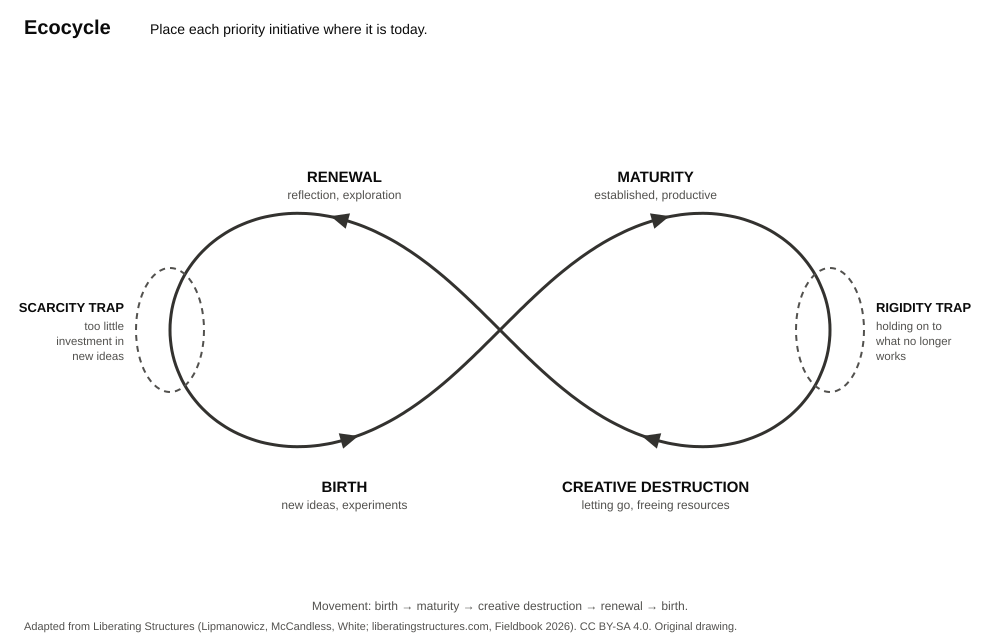

Place each priority initiative from the Panarchy chart on the Ecocycle on page 2. Then find the traps, and propose a move. This sheet supports a **30-minute adaptation**. The full [Ecocycle Planning](https://www.liberatingstructures.com/ecocycle-planning) takes about 90 minutes. See the [Panarchy page](../panarchy.qmd#ecocycle-a-30-minute-adaptation).

| Phase or trap        | Meaning                                                                                   |
| -------------------- | ----------------------------------------------------------------------------------------- |
| Birth                | A new idea or experiment. Few resources, much uncertainty.                                |
| Maturity             | An established practice. It is productive and uses most of the resources.                 |
| Creative destruction | An ending. Letting go frees attention and resources for something new.                    |
| Renewal              | Reflection and exploration. New networks and ideas form before the next birth.            |
| Rigidity trap        | Between maturity and creative destruction: holding on to a practice that no longer works. |
| Scarcity trap        | Between renewal and birth: not investing enough in new ideas, so they never grow.         |

: Phases and traps {tbl-colwidths="[24,76]"}

## Your diagnosis

```{=typst}
#set table(rows: (auto, 1.2cm))
```

::: {.worksheet}

| Initiative | Phase today | Trapped? Which trap? | Proposed move: start, stop, or support |
| ---------- | ----------- | -------------------- | -------------------------------------- |
|            |             |                      |                                        |
|            |             |                      |                                        |
|            |             |                      |                                        |

: Ecocycle diagnosis {tbl-colwidths="[28,16,20,36]"}

:::

```{=typst}
#pagebreak()
```

{fig-alt="A figure-eight loop with four phases: birth on the lower left, maturity on the upper right, creative destruction on the lower right, renewal on the upper left. The rigidity trap sits at the right end between maturity and creative destruction. The scarcity trap sits at the left end between renewal and birth." width="80%"}

::: {.callout-note title="Liberating Structures"}
The structures and illustrations used in this session are adapted under Creative Commons Attribution-ShareAlike 4.0 from the original work of Keith McCandless, Henri Lipmanowicz and Nancy White found at [www.liberatingstructures.com](https://www.liberatingstructures.com/) and the Liberating Structures Fieldbook (2026). Licensed under [CC BY-SA 4.0](https://creativecommons.org/licenses/by-sa/4.0/). The drawing is original. No Liberating Structures icons are used.
:::

[[PDF](../../assets/handouts/ecocycle.pdf) · [Word](../../assets/handouts/ecocycle.docx) · ]{.content-visible when-format="html"}This handout: [CC BY-SA 4.0](https://creativecommons.org/licenses/by-sa/4.0/) · Stochastic Parrots and Beyond, Laura Wagner and Moritz Mähr.
