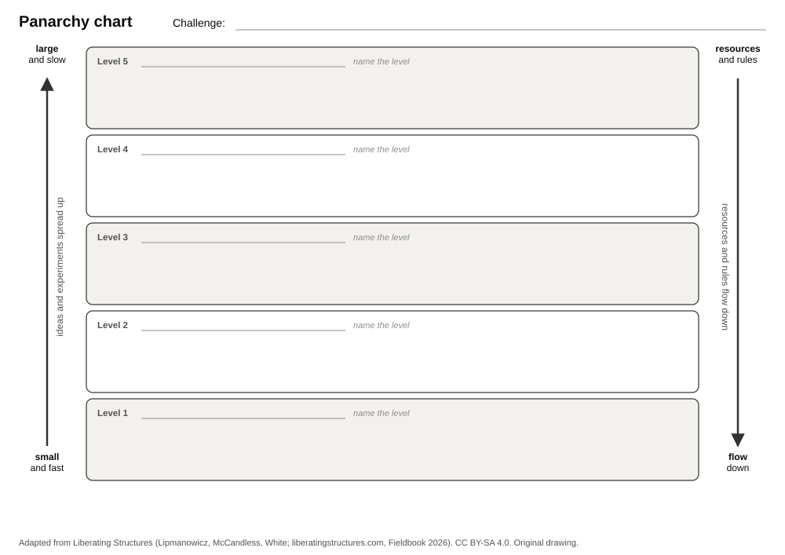

Print the chart on page 2 for each participant, and once in A1 or A0 for the wall. Name the levels with your group. Use sticky notes for influences, opportunities, and barriers. See the [Panarchy page](../panarchy.qmd).

## How to use the chart

1. Write the challenge at the top.
2. List the factors that shape the challenge, one per note.
3. Sort the notes into levels, from small and fast at the bottom to large and slow at the top. Name each level.
4. Mark levels that get little attention, and places where resources are missing.
5. Add opportunities and barriers between the levels that they connect.
6. Vote for three priorities. Note an owner and a review date for each.

The levels are yours to discover. One possible set, as an illustration only: individual research project, research group or department, university and research sector, model vendors and industry, regulation and society.

::: {.callout-note title="Liberating Structures"}
The structures and illustrations used in this session are adapted under Creative Commons Attribution-ShareAlike 4.0 from the original work of Keith McCandless, Henri Lipmanowicz and Nancy White found at [www.liberatingstructures.com](https://www.liberatingstructures.com/) and the Liberating Structures Fieldbook (2026). Licensed under [CC BY-SA 4.0](https://creativecommons.org/licenses/by-sa/4.0/). The drawing is original. No Liberating Structures icons are used.
:::

[[PDF](../../assets/handouts/panarchy-chart.pdf) · ]{.content-visible when-format="html"}This handout: [CC BY-SA 4.0](https://creativecommons.org/licenses/by-sa/4.0/) · Stochastic Parrots and Beyond, Laura Wagner and Moritz Mähr.

```{=typst}
#pagebreak()
```

{fig-alt="Blank Panarchy chart with five horizontal bands from small and fast at the bottom to large and slow at the top. Each band has a field for its level name. An arrow on the left points up: ideas and experiments spread up. An arrow on the right points down: resources and rules flow down." width="86%"}
