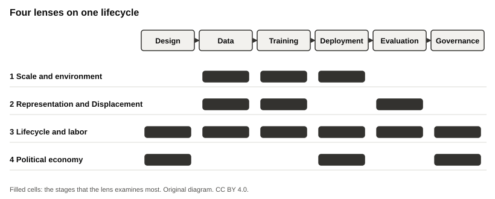

## License {.smaller}

These slides are licensed under [CC BY 4.0](https://creativecommons.org/licenses/by/4.0/). You can copy, change, and teach them if you give credit.

Source and handouts: [maehr.github.io/stochastic-parrots-and-beyond](https://maehr.github.io/stochastic-parrots-and-beyond/)

Press `S` for the presenter notes and `?` for the keyboard shortcuts.

::: notes
Open with the license slide only briefly. It tells participants that they may keep and reuse everything. Then move to the question.
:::

## Our question

> How can we make — and defend — a responsible decision about generative AI in our own research?

- Not a list of permitted and forbidden tools.
- A transparent position that you can explain to colleagues, reviewers, and the people your research affects.

::: notes
Ask: "Who has used a generative AI system for research this month?" Do not ask for details yet. Transition: "Before we judge a use, we need ways of looking at it. We use four lenses."
:::

## Four lenses

1. **Scale and environment.** What does a model cost, and where do its data come from?
2. **Representation and Pygmalion.** Whose perspectives become normal?
3. **Lifecycle and labor.** Who does the work, and who carries the risk?
4. **Political economy.** Which incentives keep a practice in place?

In the afternoon, **Panarchy** connects the lenses to the levels where change is possible.

::: notes
Name each lens with its question. Point out that the lenses overlap on purpose. A single use can raise questions in all four.
:::

## One lifecycle, six stages

{fig-alt="Diagram of the six lifecycle stages in a row: design, data, training, deployment, evaluation, governance. Above the row, four bands mark which stages each lens examines most: scale and environment covers data, training, and deployment; representation covers data, training, and evaluation; lifecycle and labor covers all six stages; political economy covers design, deployment, and governance."}

[Original diagram. CC BY 4.0.]{.source}

::: notes
Read the stages from left to right. Say that we will mark risks at each stage. Transition: "Let us start with one research use and look at it through all four lenses."
:::

## A short case {.smaller}

[Hypothetical example]{.label}

A doctoral candidate in history wants to use a hosted chatbot to summarize 200 digitized newspaper articles for a literature review.

| Lens                  | First question                                                      |
| --------------------- | ------------------------------------------------------------------- |
| Scale and environment | What is known about the model's training data and energy use?       |
| Representation        | Whose voices does the summary make typical, and whose does it drop? |
| Lifecycle and labor   | Who labeled the data, and who checks the summaries?                 |
| Political economy     | What does the provider gain, and what does the university pay?      |

[This example is invented for teaching.]{.source}

::: notes
Ask the group to add one question per lens. Write them on the wall. They come back in the lessons.
:::

## Concepts we use all day {.smaller}

- **Stochastic parrot:** a system that stitches together linguistic forms from its training data "without any reference to meaning" (Bender et al. 2021, 617).
- **Documented vs. hypothetical:** we mark every example. A product name is not evidence.
- **Known, unknown, avoidable:** three columns for every cost.
- **Levels:** a change in a project, a department, a university, an industry, or a law.

::: notes
Stress the difference between documented and hypothetical. Ask participants to challenge any claim that has no source.
:::

## Activity: your research use · 7 minutes

1. **Alone, 2 minutes.** On a card, write one actual or planned use of generative AI in your research: the task, the system, why you might use it, and what you do not know about it.
2. **Pairs, 5 minutes.** Read your cards to each other. Add one question from a lens.

Do not write confidential or personal data on the card.

::: notes
Hand out cards. Keep strict time. Collect the cards on the wall only if the authors agree. The cards stay anonymous.
:::

## Expected output

- One card for each participant, with one research use.
- A wall of anonymous research uses that we return to in every lens.

Each lens adds one worksheet. The afternoon adds a Panarchy chart, an Ecocycle diagnosis, and your own next action.

::: notes
Transition: "Your card is the thread of the day. In the clinic at the end, you turn it into a position."
:::

## The day

1. Four lenses, one after the other.
2. Integrate the lenses and agree on the Panarchy challenge.
3. Panarchy: a facilitated discussion across levels.
4. Ecocycle: a short adaptation to sort the priorities.
5. Research-use clinic and peer review.
6. Next actions and the follow-up task.

[The edition page gives the times.]{.source}

::: notes
Do not give times on this slide. They belong to the edition page, so that the deck works for every edition.
:::

## Sources {.smaller}

- Bender, Gebru, McMillan-Major, and Shmitchell (2021): [On the Dangers of Stochastic Parrots](https://doi.org/10.1145/3442188.3445922).
- Course website: [lenses, handouts, and literature](https://maehr.github.io/stochastic-parrots-and-beyond/).

## Takeaway

> We do not look for permission. We look for reasons that we can defend.

[Stochastic Parrots and Beyond · Laura Wagner and Moritz Mähr · CC BY 4.0]{.source}

::: notes
Transition to Lens 1: "The first lens asks what a model's performance hides."
:::
