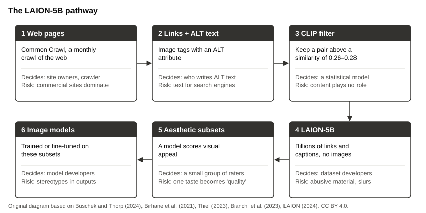

## Learning question

> Whose perspectives become normal and whose are displaced?

[Content note: this lens discusses stereotypes and harmful material in datasets. We describe it. We never show it.]{.source}

::: notes
Read the content note aloud. Say that participants can step out at any time. Do not show any image from the audited datasets, not even blurred.
:::

## 1. Datasets encode categories {.smaller}

- LAION-5B: image links from Common Crawl, kept if the ALT text matched the image according to CLIP (threshold 0.26 to 0.28).
- A change of 0.01 would have removed 937,489,831 pairs.
- "What the images contain plays no role at all in deciding what stays and what goes."
  - CLIP compares image and text. A similarity score tests neither consent, nor representation, nor fitness for use.
- The dataset shows "less about how humans see the world than it does about how search engines see the world."

[Buschek and Thorp (2024), Models All the Way Down, Knowing Machines.]{.source}

::: notes
Explain ALT text: it describes images for screen readers, but often serves search engines. Ask: "Who writes ALT text on shopping sites, and for whom?"
:::

## 2. "Quality" is a judgement by particular people

- LAION's aesthetic subsets come from a model that learned from human ratings.
- The raters: AI art communities and photography reviewers. Of 41 top reviewers with a location, 95% were in the US, Canada, or Europe.
- Models fine-tuned on these subsets learn their idea of a "good" image.

[Buschek and Thorp (2024).]{.source}

::: notes
Ask: "Whose taste would rate the images of your discipline's sources?"
:::

## 3. Stereotypes appear without being asked for

- Ordinary prompts for traits, occupations, or objects produced stereotypes in Stable Diffusion.
- Whiteness appeared as an ideal. Occupations amplified racial and gender disparities.
- Neither counter-stereotypical prompts nor the provider's guardrails prevented this.

[Bianchi et al. (2023), FAccT.]{.source}

::: notes
Do not run a live demonstration. Describe the findings, and refer to the paper.
:::

## 4. Pygmalion displacement

- Pygmalion, repulsed by women, carved a statue that came to life.
- Erscoi, Kleinherenbrink, and Guest trace a repeated pattern: women replaced by automata and algorithms.
- They find it, unacknowledged, in Turing's imitation game.

> Who is designed as the helpful, feminine assistant, and whose work and presence does it replace?

[Erscoi, Kleinherenbrink, and Guest (2023), SocArXiv.]{.source}

::: notes
Ask the group to name assistants and their designed voice or gender. Then ask which human work they claim to replace.
:::

## 5. Personalization and non-consent

- Almost 35,000 downloadable "deepfake" model variants of identifiable people, downloaded almost 15 million times.
- 96% targeted women. Many signalled the intent to create non-consensual intimate imagery.
- As few as 20 images and 15 minutes on consumer hardware.

[Hawkins, Mittelstadt, and Russell (2025), FAccT.]{.source}

::: notes
Keep the discussion on structures: platforms, licenses, moderation. Do not name targeted persons.
:::

## Case: the LAION-5B pathway

[Documented case]{.label}

{fig-alt="Flow diagram with six steps: web pages in Common Crawl; image links with ALT text; CLIP similarity filter; LAION-5B with billions of links; an aesthetic subset; image models trained or fine-tuned on these subsets."}

[Original diagram based on Buschek and Thorp (2024), Thiel (2023), and LAION (2024). CC BY 4.0.]{.source}

::: notes
Walk through the steps from left to right. At each step, ask: "Who decided here?"
:::

## Audit and repair {.smaller}

- 2021: an audit of LAION-400M finds explicit images of rape and pornography, malign stereotypes, and slurs (Birhane, Prabhu, and Kahembwe).
- December 2023: the Stanford Internet Observatory reports links to suspected child sexual abuse material in LAION-5B (Thiel). LAION takes the dataset offline on 19 December.
- 30 August 2024: Re-LAION-5B removes 2,236 links that matched partner lists (LAION).
- Models already trained on the original did not change.

::: notes
The dataset was open, so outsiders could audit it. Ask: "What would an audit of a closed dataset require?"
:::

## Activity · 15 minutes

**Analyze a representation pathway.** Groups of three or four, on paper or on a laptop. Do not search for harmful images.

1. Choose a research-use card from your group. Use LAION-5B only if no card fits. (3 min)
2. For each step: who decides, what is selected, what is excluded, which harm can enter. (8 min)
3. Mark the riskiest step and the people it affects. (2 min)
4. Name one mitigation that a researcher controls. (2 min)

[Worksheet: Lens 2, representation and harm pathway]{.source}

::: notes
Hand out the Lens 2 worksheet. If a group wants to test a tool live, ask it to use only neutral, non-identity prompts and to describe the results instead of displaying them.
:::

## Expected output

A **representation and harm pathway** for each group:

- each step with decision-makers, selections, exclusions, and possible harms,
- the riskiest step and the people affected,
- one mitigation under the researcher's control.

## Sources {.smaller}

- Erscoi, Kleinherenbrink, and Guest (2023): [Pygmalion Displacement](https://doi.org/10.31235/osf.io/jqxb6).
- Buschek and Thorp (2024): [Models All the Way Down](https://knowingmachines.org/models-all-the-way).
- Birhane, Prabhu, and Kahembwe (2021): [Multimodal Datasets](https://arxiv.org/abs/2110.01963). Content note.
- LAION (2024): [Releasing Re-LAION-5B](https://laion.ai/blog/relaion-5b/).

## Takeaway

> "Typical" is a decision. Ask who made it, with which data, and who is missing from the result.

::: notes
Transition to Lens 3: "Behind every dataset and every filter, people work. The next lens follows them."
:::
